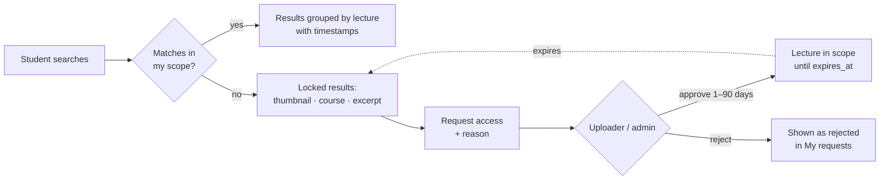

# LectureLens

**Semantic search over lecture transcripts.** Students search across recorded lectures *by meaning* and jump straight to the exact timestamp where a topic is explained.

> *"Where in any of my courses is deadlock prevention explained?"* → `CS302 · Lecture 7 — Deadlock Prevention · ▶ 23:41`

DBMS Experiential Learning, Mini project 

---

## Contents

- [LectureLens](#lecturelens)
  - [Contents](#contents)
  - [The problem](#the-problem)
  - [Features](#features)
  - [How access works](#how-access-works)
  - [Tech stack](#tech-stack)
  - [Database design](#database-design)
    - [Advanced database features](#advanced-database-features)
  - [Semantic search](#semantic-search)
  - [Project status](#project-status)
  - [Getting started](#getting-started)
    - [Prerequisites](#prerequisites)
    - [1. Run the database test suite (no Docker needed)](#1-run-the-database-test-suite-no-docker-needed)
    - [2. Run the app (Docker + Next.js)](#2-run-the-app-docker--nextjs)
  - [Repository structure](#repository-structure)
  - [Security](#security)
  - [Team](#team)
  - [Documentation](#documentation)

---

## The problem

`Ctrl+F` searches one transcript, literally, in one video, and so does YouTube's in-video search. There is no way to ask a question across a whole semester of lectures and get a timestamped answer. A student also has no way to find out that a relevant lecture exists in a course they aren't enrolled in.

LectureLens runs one semantic query over everything you're allowed to see. It returns the matching passages, grouped by lecture, each with a jump-to-timestamp link. If nothing in your scope matches but something outside it does, you see that it exists, locked, and can request access to that one lecture.

## Features

| | |
|---|---|
|  **Semantic search** | Finds explanations by meaning, not exact wording. Up to 3 passages per lecture, each with a timestamp |
|  **Keyword search** | Full-text mode for exact terms such as course codes, acronyms and names |
|  **Jump to timestamp** | YouTube player plus the full transcript. Click any passage to seek to it |
|  **Locked discovery** | Matching lectures outside your access are shown with a thumbnail, course and excerpt only |
|  **Access requests** | Request one lecture with a reason. The instructor who uploaded it approves (7 days by default) or rejects |
|  **My requests** | Pending / approved / rejected, with "active until …" or "expired" |
|  **Instructor inbox** | Pending requests with a badge count, approve with a custom duration |
|  **Transcript ingestion** | Upload `.srt` / `.vtt`. A stored procedure chunks it, and the app embeds each chunk |
|  **Course analytics** | Content coverage, search activity, access demand, and questions nobody's lectures answer |
|  **Role-based access** | Student, instructor and admin, enforced **inside PostgreSQL** and not only in the API |

## How access works

A student can open a lecture through two independent paths. The union of the two is recomputed live on every query and never cached:

```
ACCESS(student, lecture) =
      lecture ∈ a course the student is ENROLLED in        -- permanent, granted by admin
   OR an APPROVED request for that lecture, not yet expired -- temporary, granted by its uploader
```



| Role | Searches over | Can also |
|---|---|---|
| **Student** | enrolled courses ∪ active grants | request access, view own requests |
| **Instructor** | courses they teach | manage lectures, upload transcripts, decide requests for lectures they uploaded |
| **Admin** | everything | manage users, courses and enrollments, decide any request |

## Tech stack

| Layer | Choice |
|---|---|
| Frontend + API | **Next.js** (App Router, Route Handlers) |
| Relational database | **PostgreSQL 16**: courses, lectures, enrollments, requests, logs |
| Vector database | **pgvector 0.8** in the same PostgreSQL: transcript chunk embeddings, HNSW index |
| Embeddings | **all-MiniLM-L6-v2** (384-d), run locally with `@huggingface/transformers`. No API key needed |
| Auth | Auth.js credentials provider + bcrypt |
| DB driver | `node-postgres` with plain, parameterised SQL (no ORM) |
| Video | Unlisted YouTube videos via the IFrame API |

**Why pgvector instead of a separate vector database?** Every search has to be filtered by the live access union. In the same database, similarity ranking, the access check and the joins all run in one transactional query. A separate vector store would need a synced copy of the access rules, and those go stale the moment a grant expires.

## Database design

10 relations, all in BCNF. Each arrow runs from a foreign key to the primary key it references:


| Table | Holds |
|---|---|
| `app_user` | Users and their role (`student` / `instructor` / `admin`), bcrypt password hash |
| `course`, `course_instructor` | Courses and who teaches them (every course has ≥ 1 instructor) |
| `enrollment` | Access path 1: student ↔ course |
| `lecture` | One video per row, with its YouTube id, number and duration |
| `transcript` | Exactly one per lecture. `uploaded_by` is the sole approver for that lecture |
| `transcript_chunk` | ~120-word passages with `start_sec`, `vector(384)` embedding and `tsvector` |
| `access_request` | Access path 2: a request, which becomes a time-limited grant once approved |
| `search_log`, `search_hit` | Searches and the lectures they surfaced, used by the analytics |

### Advanced database features

| Feature | Where it's used |
|---|---|
| **Vector similarity search** | HNSW index (cosine) on `transcript_chunk.embedding`, `search_lectures()` |
| **Stored procedures / functions** | `ingest_transcript` (chunking), `set_chunk_embeddings`, `create_course`, `decide_request`, `request_access`, `search_lectures`, `accessible_lectures` |
| **Triggers** | Role checks; "can't request what you already have"; only the uploader or an admin may decide; the reason can't be edited; a course always keeps an instructor (deferred) |
| **Views + materialized view** | Access union, request history, course-wise analytics, daily search counts |
| **Transactions & concurrency** | `SELECT … FOR UPDATE` in `decide_request`, so two people approving at once can't both succeed. Transcript and its chunks are ingested atomically |
| **Indexing** | HNSW, GIN, partial unique (one pending request per student and lecture), partial, expression (`lower(email)`) |
| **Full-text search** | Generated `tsvector` column with GIN, `websearch_to_tsquery`, `ts_headline` |
| **Database-level RBAC** | Least-privilege login role, column privileges, row-level security, `SECURITY DEFINER` functions |

## Semantic search

1. **Ingest:** an instructor uploads `.srt` / `.vtt`. The app parses it into cues and `CALL ingest_transcript(...)` packs them into ~120-word / 60-second chunks with a one-cue overlap. The app then embeds each chunk and `CALL set_chunk_embeddings(...)` stores the vectors.
2. **Search:** the query is embedded with the same model. `search_lectures()` resolves the caller's scope, takes the 200 nearest chunks inside it by cosine distance (`<=>`), drops anything with distance above 0.55, and keeps the 3 best passages for each of the top 10 lectures.
3. **Locked discovery:** if nothing in scope matches, the same search runs over lectures *outside* the scope. It returns one locked row per lecture, with no video id and no timestamp.


## Getting started

### Prerequisites

- Python 3.10+ (for the database test suite)
- Docker Desktop (to run PostgreSQL + pgvector)
- Node.js 20.12+ (for the web app)

### 1. Run the database test suite (no Docker needed)

The suite starts a throwaway PostgreSQL 16 + pgvector (bundled by the `pgserver` pip package), applies every migration, drops everything with `000_reset.sql`, re-applies, seeds sample data, and checks every business rule plus the important queries.

```bash
python -m pip install pgserver psycopg2-binary
```

```bash
python db/tests/run_tests.py
```

Expected last line: `44/44 passed`. Detailed results are written to `db/tests/test_results.json`.

> The bundled server has pgvector 0.6, so the test runner skips the one `hnsw.iterative_scan` setting that needs 0.8. The Docker image below supports it.

### 2. Run the app (Docker + Next.js)

```bash
cp .env.example .env.local                      # then replace every change-me and AUTH_SECRET
docker compose --env-file .env.local up -d      # PostgreSQL 16 + pgvector 0.8 on localhost:5432
npm install
npm run db:migrate                              # applies db/migrations in order (db:reset rebuilds from scratch)
npm run db:seed                                 # demo users, 3 courses, 9 lectures; embeds the sample transcripts
npm run dev                                     # http://localhost:3000
```

- `db:seed` downloads the MiniLM model once (~23 MB). It expects a freshly migrated database: run `npm run db:reset` first to seed again.
- Demo logins are listed at the bottom of `.env.example` (password `demo1234`): `admin@pes.edu`, instructors `rao@` / `iyer@` / `menon@`, students `asha@` / `ben@` / `chitra@`.
- The seeded lectures use placeholder YouTube ids, so the player shows "video unavailable" until real ids are set; transcripts, search and jump-to-timestamp work regardless.
- The web app connects as the least-privilege role `lecturelens_app`; only migrations and seeding use the schema owner.
- Unit tests: `npm test`.

## Repository structure

```
.
├── MODEL.md                              Application model: roles, access rules, workflows
├── LectureLens_Design_and_Work_Plan.pdf  Full design spec (40 pages)
├── docs/
│   ├── relational_schema.pdf             Schema diagram, notation, keys and constraints
│   └── relational_schema.svg
├── db/
│   ├── migrations/                       000_reset … 110_alter, applied in name order
│   ├── queries/important_queries.sql     Q1–Q8, reporting and DML examples
│   └── tests/run_tests.py                44 automated database checks
├── app/  lib/  scripts/                  Next.js application (in progress)
└── README.md
```

## Security

- Passwords are stored only as **bcrypt** hashes, and a CHECK constraint rejects anything else.
- No credentials in the source code. Configuration comes from environment variables (`.env.local` is git-ignored).
- All SQL is parameterised. User input never becomes SQL text.
- The app's database role **cannot read** transcripts, chunks or video ids directly. They come out only through functions that check access first.
- Row-level security on `access_request`: students see only their own requests, and instructors only those they approve.

## Team

| Member | Owns |
|---|---|
| **Member A** — Krish | Content, ingestion & search: courses/lectures/transcripts schema, chunking procedure, embeddings, vector + full-text search, search & player UI |
| **Member B** — Vishanth | Users, access control & analytics: users/enrollment/requests schema, access functions, triggers, approval transactions, roles + RLS, auth, requests/inbox/admin/analytics UI |


---

<sub>Built for the DBMS course at PES University. Lecture videos remain the property of their creators.</sub>
