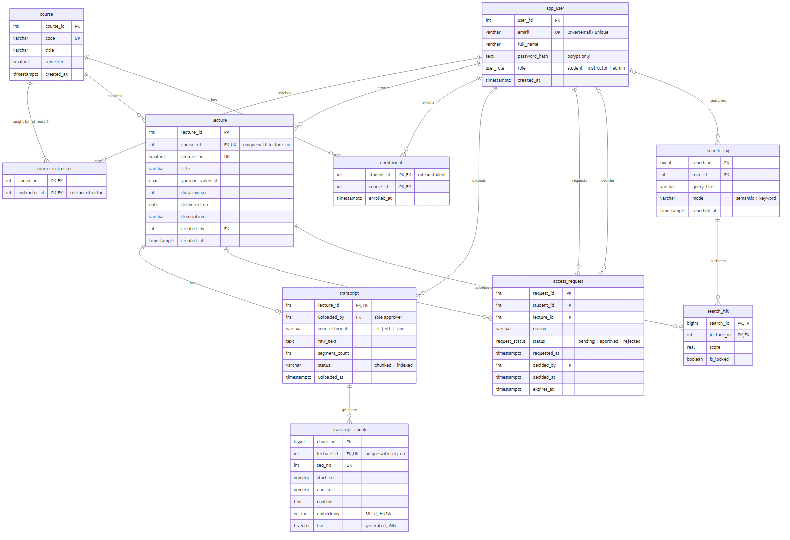
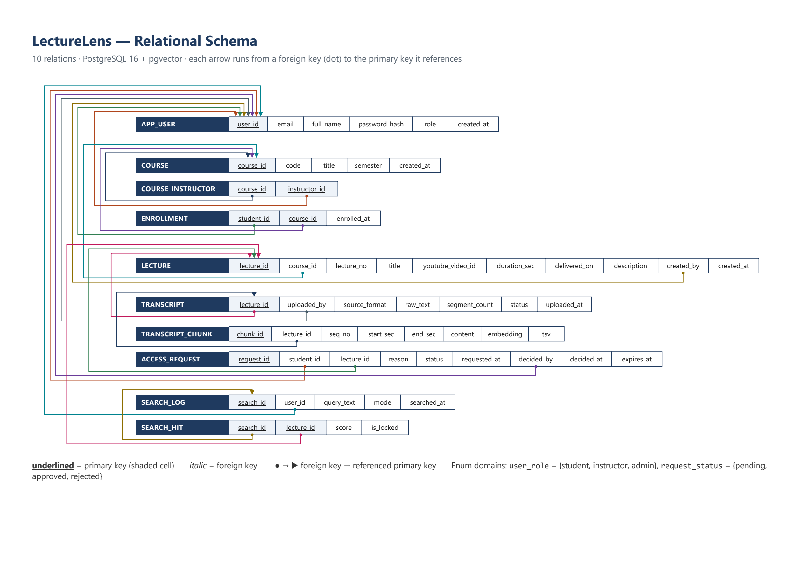

# Rewound

> Rewound searches across uploaded lectures by meaning and returns the passages most similar to your query, each with a timestamp, so you can jump to that point in the video.

| SRN | Name | Primary contribution |
|---|---|---|
| PES1UG24AM914 | Krish Mathur | Course and lecture content, transcript ingestion, embeddings, semantic and keyword search, lecture player, instructor content management. |
| PES1UG24AM323 | Vishanth | Users and enrollments, access-request workflow, database roles and row-level security, authentication, admin and analytics pages. |

## 1. Abstract

Rewound searches across uploaded lectures by meaning and returns the passages most similar to a query, each with a timestamp for jumping to that point in the video. It also supports keyword search for exact technical terms. When a relevant lecture is outside a student’s current access, the application shows a limited locked result and lets the student request access. The lecture’s transcript uploader or an administrator can approve a time-limited grant or reject the request.

PostgreSQL stores the relational course, user, lecture, enrollment, transcript, search, and request data. The pgvector extension stores transcript embeddings in the same database, allowing the similarity query and live access-scope checks to run together. Database constraints, stored functions and procedures, triggers, transactions, grants, and row-level security enforce integrity and authorization. A Next.js application provides sign-in, search, lecture playback, instructor tools, access-request workflows, administration, and analytics.

## 2. Technology Stack

| Layer | Technology | Use in Rewound |
|---|---|---|
| Web application | Next.js 14 App Router, React 18, TypeScript | Server-rendered pages, interactive components, and API Route Handlers. |
| Authentication | Auth.js credentials provider, bcryptjs, JWT sessions | Email/password sign-in, password-hash verification, and role-bearing sessions. |
| Relational database | PostgreSQL 16 | Users, courses, instructors, lectures, enrollments, transcripts, searches, and access requests. |
| Vector search | pgvector 0.8 | Stores 384-dimensional transcript-chunk embeddings and supports cosine-distance search. |
| Embedding model | `all-MiniLM-L6-v2` via `@huggingface/transformers` | Generates embeddings locally; no external embedding API key is required. |
| Full-text search | PostgreSQL `tsvector` and GIN | Supports exact terms, acronyms, and technical vocabulary. |
| Database access | `node-postgres` (`pg`) | Parameterized SQL calls to functions, procedures, views, and tables. |
| Input validation | Zod and PostgreSQL constraints | Validates API payloads and enforces durable database integrity rules. |
| Local services | Docker Compose | Runs PostgreSQL with pgvector for development. |
| Testing | Vitest; Python `pgserver`/`psycopg2` database suite | Unit checks for parsing/formatting and database behavior. |
| Version control | Git and GitHub | Tracks source, migrations, and member contributions. |

## 3. SQL – Database Commands

### Relational model

The relational schema models users and roles, courses and instructors, lectures, enrollments, transcripts and chunks, searches and search hits, and access requests. Primary and foreign keys connect the entities. Unique, check, and exclusion rules prevent invalid records; indexes support joins, lookups, and search. The course-instructor relationship is many-to-many. Enrollment grants continuing course access; an approved, unexpired request grants temporary access to one lecture.

The main migrations are under `db/migrations/`: `000` reset, `001` extension and enum types, `010` users, `020` courses and lectures, `030` enrollments and requests, `040` transcripts and chunks, `050` access functions, `060` content procedures, `070` request workflow, `080` search functions, `090` search analytics, `091` access analytics, `100` roles and RLS, `110` an additive lecture-description change, `115` instructor course-lecture listing, and `120` content grants.

### Representative DDL

```sql
CREATE TABLE enrollment (
    student_id  integer REFERENCES app_user ON DELETE CASCADE,
    course_id   integer REFERENCES course ON DELETE CASCADE,
    enrolled_at timestamptz NOT NULL DEFAULT now(),
    PRIMARY KEY (student_id, course_id)
);
```

This table uses a composite primary key to disallow duplicate student-course pairs and foreign keys to preserve referential integrity. A trigger also checks that the enrolled user has the student role.

The project demonstrates the required DDL operations across migrations:

```sql
-- CREATE: extension used for the vector type and operators
CREATE EXTENSION IF NOT EXISTS vector;

-- ALTER: additive schema evolution in migration 110
ALTER TABLE lecture ADD COLUMN description varchar(1000);

-- DROP: reset migration removes dependent tables before a clean rebuild
DROP TABLE IF EXISTS search_hit, search_log, access_request, transcript_chunk,
    transcript, enrollment, lecture, course_instructor, course, app_user CASCADE;
```

### Constraints, indexes, views, and transaction logic

- Keys and checks validate email format, course codes, semester range, positive lecture duration, timestamp order, reason length, and request decision fields.
- A deferred constraint trigger ensures every course has at least one instructor.
- A partial unique index allows at most one pending request per student and lecture. A partial index supports approved-grant lookups.
- Views provide course overview, search activity, unanswered queries, access demand, pending requests by approver, and request history. A materialized view stores daily search counts.
- `ingest_transcript()` replaces transcript data atomically; `set_chunk_embeddings()` writes vectors and updates indexing status.
- `request_access()` checks request rules. `decide_request()` locks its request row with `FOR UPDATE`, checks the approver, and records one decision and (when approved) an expiry time.
- `access_request` uses row-level security to scope request history. The app connects through the least-privilege `lecturelens_app` role rather than the schema owner.

### Representative SQL commands and query patterns

The application and `db/queries/important_queries.sql` demonstrate `SELECT`, `INSERT`, `UPDATE`, `DELETE`, joins, aggregation, `HAVING`, ordering, subqueries, CTEs, window functions, and vector reads. For example, the query below reports recent demand per course and lecture:

```sql
SELECT co.code, l.lecture_no, l.title, count(*) AS requests_30d
FROM access_request r
JOIN lecture l ON l.lecture_id = r.lecture_id
JOIN course co ON co.course_id = l.course_id
WHERE r.requested_at > now() - interval '30 days'
GROUP BY co.code, l.lecture_no, l.title
HAVING count(*) >= 3
ORDER BY requests_30d DESC;
```

The row-locking decision pattern is:

```sql
SELECT *
FROM access_request
WHERE request_id = p_request_id
FOR UPDATE;
```

The database test suite is `db/tests/run_tests.py`; its source currently declares 52 checks covering schema integrity, search scope, request validation and RLS, approval, expiry, and two-client decision concurrency. **TODO: Run the current suite and record its pass/fail result before submission. Do not reuse the earlier 44/44 result in the design document because the suite has since gained additional checks.**

## 4. NoSQL/Vector Database Commands

Rewound does not use a separate NoSQL server. For the rubric’s SQL-plus-vector option, PostgreSQL is extended with pgvector. This keeps transcript chunks, their lecture metadata, and access rules in one database. The vector column is `vector(384)` and the HNSW index uses cosine distance.

```sql
CREATE EXTENSION IF NOT EXISTS vector;

CREATE TABLE transcript_chunk (
    chunk_id   bigint GENERATED ALWAYS AS IDENTITY PRIMARY KEY,
    lecture_id integer NOT NULL REFERENCES transcript ON DELETE CASCADE,
    seq_no     integer NOT NULL CHECK (seq_no >= 1),
    start_sec  numeric(8,2) NOT NULL CHECK (start_sec >= 0),
    end_sec    numeric(8,2) NOT NULL,
    content    text NOT NULL CHECK (btrim(content) <> ''),
    embedding  vector(384),
    tsv        tsvector GENERATED ALWAYS AS (to_tsvector('english', content)) STORED,
    UNIQUE (lecture_id, seq_no),
    CHECK (end_sec > start_sec)
);

CREATE INDEX idx_chunk_embedding_hnsw
    ON transcript_chunk
    USING hnsw (embedding vector_cosine_ops)
    WITH (m = 16, ef_construction = 64);
```

Embeddings are generated from transcript chunks with `all-MiniLM-L6-v2`. Chunks retain their lecture ID, sequence number, start/end timestamps, text, and embedding. The query function applies the caller’s accessible-lecture scope inside the same SQL operation, ranks by cosine distance (`<=>`), and returns matching passages and timestamps. A starting match threshold of `0.55` is used by the search function.

```sql
-- Vector distance operator used by search and related-passage queries
SELECT chunk_id, content, embedding <=> $1::vector AS cosine_distance
FROM transcript_chunk
WHERE embedding IS NOT NULL
ORDER BY embedding <=> $1::vector
LIMIT 10;
```

The actual application calls `search_lectures(vector, limit, max_distance)` or `search_lectures_keyword(text, limit)`, which apply access filtering and disclosure rules in the database. The standalone example above illustrates the pgvector operator; production application code does not bypass those scoped functions.

## 5. Next.js – Project Tree Structure

```text
.
├── app/
│   ├── actions/auth.ts
│   ├── admin/
│   │   ├── courses/
│   │   ├── enrollments/
│   │   ├── requests/
│   │   └── users/
│   ├── analytics/
│   ├── api/
│   │   ├── analytics/       # analytics refresh
│   │   ├── auth/            # Auth.js handler
│   │   ├── chunks/          # transcript passage edit
│   │   ├── courses/         # course and lecture management
│   │   ├── enrollments/
│   │   ├── inbox/
│   │   ├── lectures/        # read, edit, transcript, thumbnail, re-embed
│   │   ├── requests/        # history, request, decision
│   │   └── search/
│   ├── inbox/
│   ├── instructor/courses/
│   ├── lectures/[id]/
│   ├── login/
│   ├── requests/
│   └── search/
├── auth.config.ts           # edge-safe Auth.js configuration
├── db/
│   ├── migrations/          # numbered PostgreSQL/pgvector migrations
│   ├── queries/              # important query examples Q1–Q12
│   ├── seed/                 # users, courses, lectures, transcripts, requests
│   └── tests/run_tests.py    # database integration suite
├── docs/
│   ├── API_AUTH_MATRIX.md
│   ├── REPORT.md
│   ├── er_diagram.png
│   ├── requirements.pdf
│   └── rubrics.pdf
├── lib/                     # auth, DB, embedding, ingestion, parsing, guards
├── middleware.ts            # signed-in and role-based page gates
├── scripts/                 # migration, seed, environment helpers
└── types/                   # Auth.js session/JWT type augmentation
```

## 6. Sample Screenshots of Application Code and Demo

### Database design screenshots

**ER diagram:**



**Relational schema:**



### Application code evidence

The following source excerpts show application/database integration and the concurrency rule. For submission, replace or supplement these rendered code excerpts with screenshots from the editor if the instructor specifically requires photographic screenshots of source code.

**TODO — Application-code screenshot:** Insert an editor screenshot of one of the implementations below.

**API request calls the database workflow (`app/api/requests/route.ts`):**

```ts
const requestId = await withUser(session.user.id, async (c) =>
  (await c.query("SELECT request_access($1, $2) AS id", [lectureId, reason])).rows[0].id,
);
return Response.json({ ok: true, requestId }, { status: 201 });
```

**Concurrent decisions serialize in PostgreSQL (`db/migrations/070_request_workflow.sql`):**

```sql
SELECT * INTO r
FROM access_request
WHERE request_id = p_request_id
FOR UPDATE;
```

### Live application demo screenshots

**TODO — Demo screenshots:** Insert screenshots from the live seeded application before submission. Suggested sequence:

1. Student semantic search showing an in-scope timestamped passage and a locked result.
2. Request-access dialog and the student’s request history.
3. Instructor inbox with the pending request and the approval action.
4. Student reopening the newly approved lecture and jumping to a transcript timestamp.
5. Admin analytics dashboard (optional additional screenshot).

The source excerpts above provide code evidence. Seeded lecture video IDs are demo placeholders; the transcript search and timestamp flow works, but the YouTube player displays unavailable until real IDs are configured. **TODO (if a working player screenshot is required): Replace the demo video IDs with playable video IDs.**

## 7. Evaluation Rubrics – Completion Status

Status reflects repository evidence as reviewed for this draft. “Partial” items need the noted evidence before final submission; these are completion statuses, not an instructor score.

| Rubric requirement | Status | Evidence / remaining item |
|---|---|---|
| 1. Project title | Complete | Rewound title and problem domain are documented. |
| 2. Two-member team and responsibilities | Complete | Both students’ names, SRNs, and contribution areas are recorded. |
| 3. SQL plus NoSQL/vector database | Complete | PostgreSQL 16 plus pgvector 0.8 is used for relational data and embeddings. |
| 4. ER diagram and relational schema | Complete | [`er_diagram.png`](er_diagram.png) and [`relational_schema.png`](../relational_schema.png) are included in the repo. |
| 5. SQL DDL: create/alter/drop, keys, constraints, indexes, views | Complete | Numbered migrations include all listed DDL categories. |
| 6. DML and appropriate queries | Complete | `db/queries/important_queries.sql` includes joins, aggregation, subqueries, CTEs, window functions, and data changes. |
| 7. Four or more advanced database concepts | Complete | Transactions and row locks, functions/procedures, triggers, indexes, views, RLS, full-text search, and vector search. |
| 8. Vector model and retrieval explanation | Complete | This report documents model, vector shape, storage, cosine distance, HNSW, and access-scoped retrieval. |
| 9. Functional Next.js interface | Complete | Search/player, instructor tools, requests/inbox, administration, and analytics pages. |
| 10. Database/application integration and secrets | Complete | Next.js handlers use parameterized PostgreSQL queries and environment configuration. |
| 11. Authentication and authorization | Complete | Auth.js credentials, bcrypt hashes, three roles, middleware, API guards, and database enforcement. |
| 12. Validation and integrity | Complete | Zod validation plus database keys, checks, triggers, and workflow constraints. |
| 13. Security | Complete | Hashed passwords, least-privilege app role, RLS, parameterized SQL, and protected video ID access. |
| 14. Project documentation and screenshots | Partial | TODO: Add live application/demo screenshots and current test results. |
| 15. Git/GitHub and README | Complete | Repository and setup instructions are present; contribution history is in Git. |
| 16. Evaluation/demo evidence | Partial | TODO: Run and capture the full search → request → approve → open → timestamp demo. |
| 17. Originality | Team confirmation | TODO: Both team members confirm originality in the final submission. |
| 18. Level 3 expectations | Complete | The project combines semantic retrieval, relational integrity, database-enforced access, and a functional application beyond basic CRUD. |

